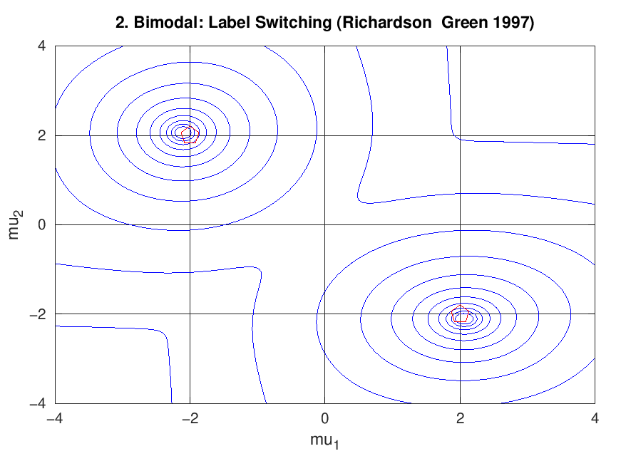
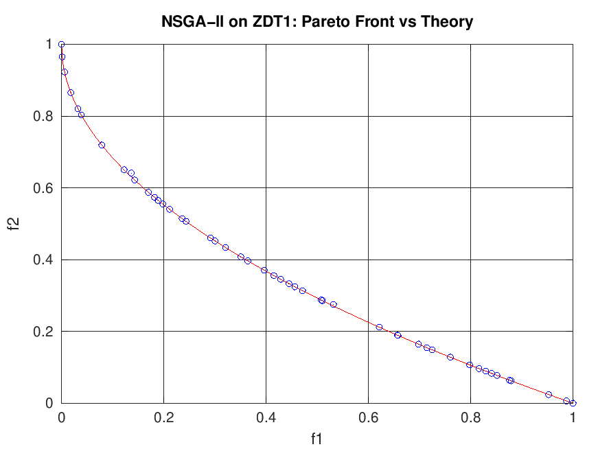
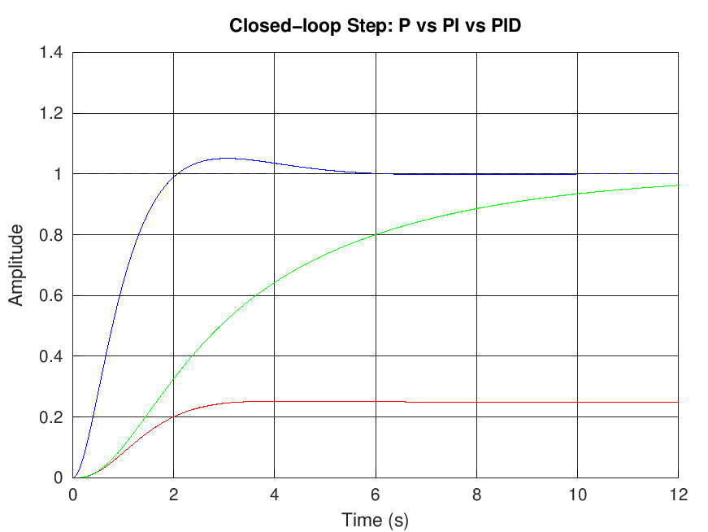
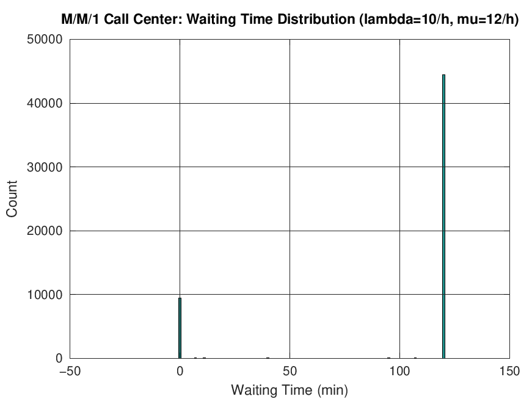
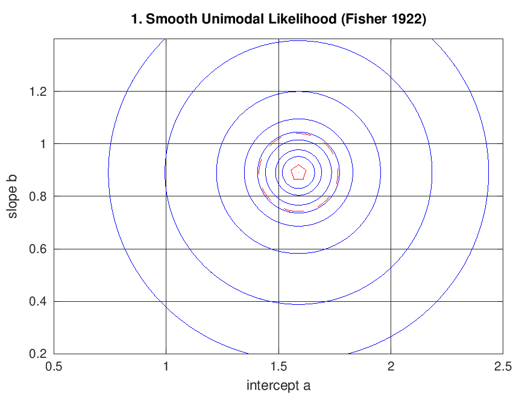
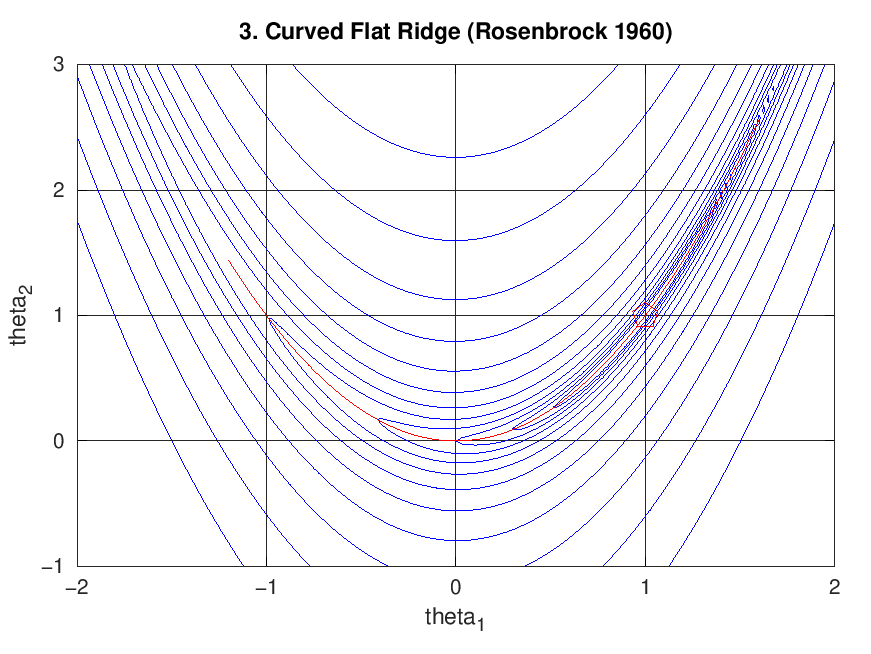
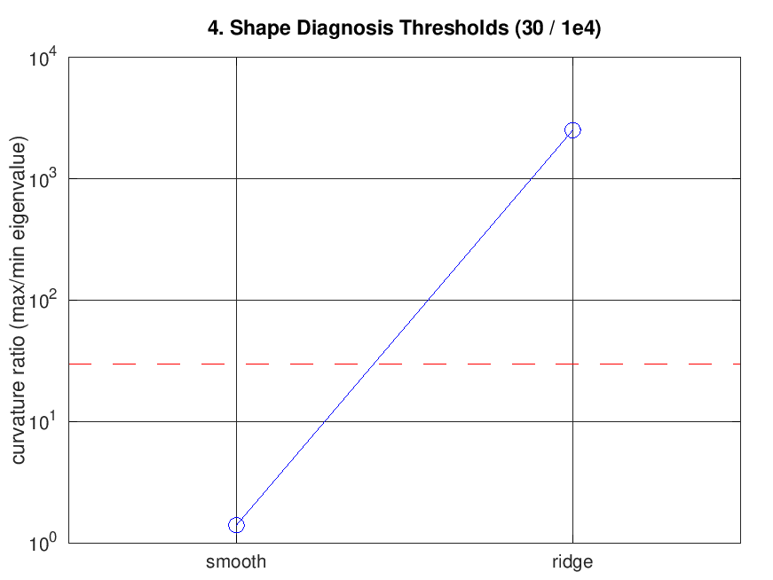

# MATLAB/Octave 仿真与算法助手（开源演示版）
# MATLAB/Octave Simulation & Algorithm Assistant (Open Demo)

> 论文级参数、可直接运行、结果可与理论对照的工程仿真代码集。
> Paper-grade parameters, directly runnable, results you can check against theory.



*似然面不是只有一个峰：等权双高斯混合的似然面有两个**等高**全局峰（标签互换）。*
*The likelihood surface is not always single-peaked: an equal-weight 2-component Gaussian mixture has two **equal-height** global modes (label switching).*



## 这是什么 / What is this

本仓库是 **「MATLAB/Octave 仿真与算法助手」技能的开源演示版**：从完整版的 26 个方法族、
25 篇论文反向测试（24/24 通过）与 16 项回归测试中，精选 4 个自包含示例供你直接运行体验。

This repo is the **open demo of the "MATLAB/Octave Simulation & Algorithm Assistant" skill**:
4 self-contained examples distilled from the full version (26 method families, 24/24 paper-based
reverse tests, 16/16 regression tests).

- ✅ **Octave 11.x 与 MATLAB R2016b+ 双兼容** / Works on both Octave and MATLAB
- ✅ 每个脚本单文件自包含，复制即跑 / Each script is a single self-contained file
- ✅ 参数带论文/标准出处，结果有理论对照 / Paper-sourced parameters, theory-anchored results

## 快速开始 / Quick Start

```bash
# Octave（开源免费）/ Octave (open source)
octave-cli demos/demo_pid_tuning.m --no-gui

# MATLAB 中直接运行脚本即可 / In MATLAB just run the script
```

## 四个精选示例 / Four Featured Demos

| Demo | 方法族 Family | 亮点 Highlight | 效果图 Figure |
|---|---|---|---|
| `demo_pid_tuning.m` | 控制 PID Control | P/PI/PID 三控制器闭环对比，指标表输出 |  |
| `demo_mm1_callcenter.m` | 排队论+蒙特卡洛 Queueing + MC | 呼叫中心案例复现论文理论值，**误差 0.8%** |  |
| `demo_nsga2_zdt1.m` + `nsga2.m` | 多目标优化 Multi-objective | NSGA-II 前沿铺满 [0,1]，贴合理论曲线偏差 0.0000 |  |
| `demo_likelihood_shapes.m` | 似然面仿真 Likelihood surface | 四形态诊断：光滑单峰 / 多峰 / 山脊 / 简并，曲率比 **2508.0 = 解析值** | 见下方四图 |

运行方式 / Run: `octave-cli demos/demo_nsga2_zdt1.m --no-gui`（其余同理 / likewise）

### 似然面四形态 / Four Likelihood-Surface Shapes

同一个极大似然流程，换个数据就换一种面形。形态决定了报告方式与求解器选择：
The same MLE pipeline yields a different surface shape per dataset — and the shape decides
what you may report and which solver to trust.

| 光滑单峰 Smooth | 多峰非凸 Multimodal |
|---|---|
|  |  |
| 曲率比 1.40，MLE = OLS 解析解 | 两个等高全局峰，标签不可辨识 |
| 平坦山脊 Ridge | 形态判据 Thresholds |
|  |  |
| 曲率比 2508.0（解析 2508.0），谷底沿 y=x² | 阈值 30 / 1e4 划分 ridge 与 degenerate |

第 4 种形态（高维简并 degenerate）不便画等高线，demo 里用 Hessian 谱给出：
秩 2/3、零空间维 1、沿零空间方向似然变化 **2.1e-28**（严格平坦），剖面判决为 `structural`。
The 4th shape is diagnosed by the Hessian spectrum instead of a contour: rank 2/3, null dim 1,
likelihood change along the null direction **2.1e-28** (exactly flat), profile verdict `structural`.

## 完整版有什么 / What's in the Full Version

开源演示只是冰山一角。完整技能覆盖 **26 个方法族**（含似然面仿真与多模型叠加混合仿真），关键词直达正确方法：
The open demos are just the tip. The full skill covers **26 method families** (incl. likelihood-surface simulation and hybrid multi-model co-simulation), routed by keyword:

- **智能优化 Intelligent optimization**: GA / PSO / 模拟退火 SA / 蚁群 ACO / NSGA-II / 网格搜索 / 穷举
- **图论与组合 Graph & combinatorial**: 最短路 Dijkstra / 网络流 Max-flow / 二分图匹配 Hungarian / DP / 回溯 / 分支定界
- **仿真 Simulation**: 蒙特卡洛 / 离散事件 / 多智能体 Boids / 代理模型 RBF-Kriging / 数字孪生（卡尔曼同化）/ **似然面 Likelihood surface** / **多模型叠加混合仿真 Hybrid multi-model co-simulation**
- **学习 Learning**: BP 神经网络 / LMS / RLS / 在线自适应
- **数学规划 Math programming**: 线性 glpk / 整数 / 二次 qp / 多目标
- **拟合与数值 Fitting & numerics**: leasqr / lsqnonlin / 插值样条 / ODE / 图像处理

### 质量证据 / Quality evidence

- 25 篇论文/标准案例反向测试 **24/24 通过**（呼叫中心误差 0.8%、CWRU 轴承 BSF 突出 8.7×、
  LP 影子价格验证精确命中、GA/SA 均达 TSP 穷举最优、Rosenbrock 曲率比 2507 vs 解析 2508、
  等权混合双峰高度差 0、sloppy 谱逐点 0.0% 偏差……）
- 自写算法库回归测试 **16/16 PASS**（每个算法配已知解判定，含似然面/剖面/混合叠加三项）
- 24/24 paper-based reverse tests passed; 16/16 regression tests on the in-house algorithm library.

## 获取完整版 / Get the Full Version

完整版上架于 WorkBuddy 技能市场（含 26 方法族路由、23 个实测算法实现、14 份方法参考、24 个论文复现脚本）。
The full skill is published on the WorkBuddy skill marketplace (26 method families, 23 tested implementations, 14 references, 24 paper scripts).

> 🔗 **WorkBuddy 客户端 → 技能市场 → 搜索「MATLAB/Octave 仿真与算法助手」**
> （链接上架后更新 / link to be updated after publishing）

## 环境要求 / Requirements

> **不装环境也能评估质量**：README 里的效果图与验证数字全部是实跑输出，
> 先看图、先看数字，判断水平够不够，再决定要不要装。
> You can judge the quality without installing anything: every figure and number
> in this README is real program output.

### 免费方案（推荐）/ Free option (recommended)

**GNU Octave** —— 开源免费（GPLv3），与 MATLAB 语法高度兼容，本仓库全部示例可直接运行。
GNU Octave is open source (GPLv3) and largely MATLAB-syntax compatible.

- 官方下载页 Official: <https://www.octave.org/download.html>
- Windows 安装包直链（官方源）: <https://ftp.gnu.org/gnu/octave/windows/>
- 国内镜像（下载更快）China mirrors:
  - 清华 TUNA: <https://mirrors.tuna.tsinghua.edu.cn/gnu/octave/windows/>
  - 中科大 USTC: <https://mirrors.ustc.edu.cn/gnu/octave/>
- 包管理器 Package managers:
  ```bash
  winget install GNU.Octave        # Windows
  brew install octave              # macOS
  sudo apt install octave          # Debian / Ubuntu
  ```

### 商业方案 / Commercial option

**MATLAB** 为 MathWorks 商业软件，**请通过官方渠道获取正版授权**（无开源版本、无第三方镜像）。
MATLAB is commercial software from MathWorks — obtain it **only through official channels**
(there is no open-source build and no legitimate third-party mirror).

- 官方（中文站）: <https://ww2.mathworks.cn/products/matlab.html>
- 有正版授权的用户：R2016b+ 可直接运行本仓库示例，无需改动。

### 其他开源替代（语法相近，非本仓库官方支持）/ Other open-source alternatives

- **Scilab**（开源，含 Xcos 图形化建模）: <https://www.scilab.org/download>
- **Python 科学计算栈**（NumPy / SciPy / Matplotlib）: 生态更强，但语法不兼容，需自行改写脚本。

### 依赖说明 / Dependencies

- 只有 `demo_pid_tuning.m` 需要 `control` 包: `pkg install -forge control`
- 其余三个示例（含 `demo_likelihood_shapes.m`）**零依赖，仅用核心函数**
- 验证安装 / Verify:
  ```bash
  octave-cli --version
  octave-cli demos/demo_likelihood_shapes.m --no-gui -q
  ```

## License

MIT © 2026 why（见 [LICENSE](LICENSE)）。完整版技能的版权归作者所有，未经许可不得二次分发。
MIT for this demo repo. The full skill is proprietary; redistribution requires permission.
